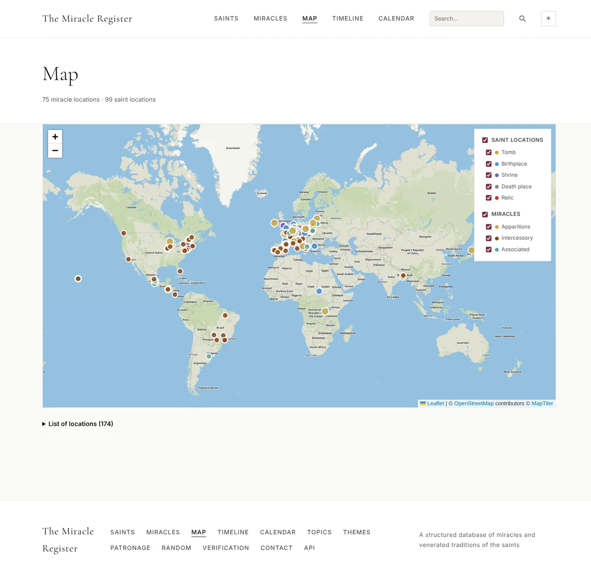
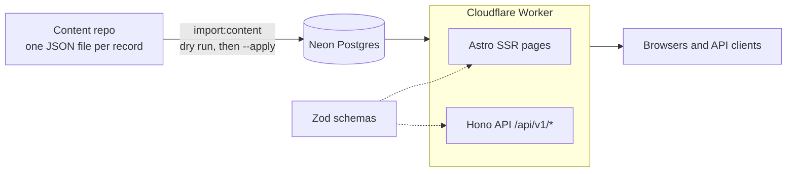

# The Miracle Register

[](https://github.com/Labnerd-net/TheMiracleRegister/actions/workflows/ci.yml)
[](LICENSE)
[](#licensing)

A searchable database of miracles attributed to Catholic saints, with a public REST API.

**Live site: [themiracleregister.org](https://themiracleregister.org)** | **API docs: [themiracleregister.org/api](https://themiracleregister.org/api)**

<picture>
  <source media="(prefers-color-scheme: dark)" srcset="docs/screenshots/home-dark.webp">
  
</picture>

<details>
<summary>More screenshots</summary>




</details>

No existing site exposes saint intercession miracles as structured, queryable data. Miracle Hunter and similar sites collect case write-ups, but none lets you filter by saint, diagnosis, approval authority, country or time period, or build on the data through an API.

Each miracle is a record, not an article. A healing links to the saint's canonization case, the recipient's diagnosis and cure characteristics, the medical board verdict that examined it, the decree or other authority that recognized it, and the sources behind the write-up. That structure lets you ask "show me every Vatican-approved miracle used for a canonization" and get an answer.

Currently 30 saints and 85 records are published (68 miracles and 17 apparitions).

## Features

- Browse and filter saints and miracles by type, topic, theme, country, patronage and canonization stage
- Full-text search with phrase, `OR` and exclusion operators, stemmed and accent-insensitive
- Feast day calendar, including movable feasts resolved against the Easter date
- Map of shrines, tombs and birthplaces, and a miracle timeline
- Source trail on every record, with a documented verification methodology
- Read-only REST API with a generated OpenAPI spec and an interactive reference
- Machine-translated Spanish saint pages

## Tech Stack

| Layer | Choice |
|---|---|
| Language | TypeScript, full stack |
| Frontend | [Astro](https://astro.build) (SSR) with the Cloudflare adapter |
| API | [Hono](https://hono.dev) at `/api/v1/*`, same Worker as the site |
| Hosting | Cloudflare Workers with static assets |
| Database | [Neon](https://neon.tech) serverless Postgres |
| ORM | [Drizzle](https://orm.drizzle.team) |
| Validation, types, OpenAPI | [Zod](https://zod.dev) via `@hono/zod-openapi` |
| Tests | Vitest on in-process PGlite databases |
| CI/CD | GitHub Actions check, deploys through Cloudflare Workers Builds |

## Architecture



Zod schemas are shared by the pages and the API and generate the OpenAPI spec, so the spec cannot drift from the implementation.

## Engineering Highlights

- **Files as the source of truth.** Content lives as one JSON file per saint and miracle in a separate repository and goes through pull request review. `npm run import:content` upserts the files in a single transaction. It is a dry run by default and prints a field-level diff. It never publishes, never deletes, and refuses changes to published rows unless asked. The same data-integrity rules that `npm run check:data` runs also run inside the import transaction, and new errors roll it back.
- **Deliberate retirement path.** Taking a record down is a separate script, `retire:content`, with its own dry run and safeguards, so an import can never remove content by omission.
- **Postgres full-text search.** Stored generated `tsvector` columns with GIN indexes, an `unaccent` wrapper so the columns can be indexed, weighted fields and `websearch_to_tsquery`. Results are ranked, and the page and the true total come from one statement.
- **Tests that never touch production.** Each test file builds its own PGlite database from the real `drizzle/` migrations, so CI needs no secrets and fork pull requests pass. There are 40 test files covering the API, importer, search, privacy rules and data checks.
- **Privacy by construction.** Recipients can be marked confidential or first-name-only. Redaction is applied in the API layer and checked by tests and by a `check:data` rule that looks for restricted names in free text.
- **Data integrity checks.** `check:data` enforces slug format, controlled vocabularies, source coverage, mirrored relations, feast field validity and more, and exits non-zero on errors.
- **Guarded production operations.** There is a single production database branch, so `db:migrate` and `import:content --apply` print the target and require confirmation. Non-interactive runs refuse without `--yes`.
- **Operational details.** Slug renames are recorded by database triggers and served as 301 redirects. Rate limiting uses Workers bindings and fails open. Cache policies are set per page type. Wikimedia images are rewritten to sized thumbnails. Structured data (JSON-LD), canonical URLs and a sitemap are generated, and accessibility and color contrast are tested.

## API

Free, read-only and keyless. Interactive reference: [themiracleregister.org/api/reference](https://themiracleregister.org/api/reference).

```bash
curl "https://themiracleregister.org/api/v1/miracles?approval_authority=vatican_dicastery&used_for_canonization=1&limit=1"
```

```json
{
  "data": [
    {
      "id": 714,
      "slug": "healing-of-maria-pellemans",
      "title": "Healing of Maria Pellemans",
      "type": "healing",
      "country": "France",
      "date_of_event": "1923-03-01",
      "date_precision": "month",
      "was_medically_verified": true,
      "approval_authority": "vatican_dicastery",
      "cure_details": "Sudden and complete healing while kneeling at Therese's tomb in Lisieux ...",
      "used_for_beatification": false,
      "used_for_canonization": true,
      "saints": [{ "id": 317, "slug": "therese-of-lisieux", "name": "Thérèse of Lisieux" }]
    }
  ],
  "meta": { "page": 1, "limit": 1, "total": 27 },
  "error": null
}
```

(Trimmed: `topics`, `recipient_name` and the full `cure_details` are omitted.)

| Method | Path | Description |
|---|---|---|
| GET | `/api/v1/saints` | List saints (canonization_stage, theme, religious_order, nationality, page, limit) |
| GET | `/api/v1/saints/:slug` | One saint with related saints and linked miracles |
| GET | `/api/v1/miracles` | Search and filter (saint_id, type, topic, category, country, year_from, year_to, used_for_beatification, used_for_canonization, approval_authority, page, limit) |
| GET | `/api/v1/miracles/:slug` | One miracle with full details, sources and images |
| GET | `/api/v1/search` | Full-text search over saints and miracles (q, topic, page, limit); `q` supports `"phrases"`, `OR` and `-exclusions` |
| GET | `/api/v1/types` | Miracle types |
| GET | `/api/v1/metadata` | Canonical filter options |
| GET | `/api/v1/doc` | OpenAPI 3 spec |

Responses use a `{ data, meta, error }` envelope. The API is rate limited to 60 requests per minute per client.

## Local Development

Requires Node 22.13 or later (`.nvmrc` pins the version CI uses).

```bash
npm install
cp .env.example .env     # set DATABASE_URL
npm run types            # generate Worker types
npm run dev
```

```bash
npm test                 # unit and integration tests, no database needed
npm run typecheck
npm run lint
npm run build
```

`npm run dev` reads from the database in `DATABASE_URL`. The tests do not use it. The site's content is not included in this repository, so to run the site locally you need your own Postgres database with the schema applied (`npm run db:migrate`) and your own content files for `npm run import:content`.

## Project Status

The site, API, search, calendar, map and importer are live. Not built yet: end-to-end tests (Playwright), a Prettier-formatted codebase and a larger corpus of published records.

## Licensing

- **Code:** [MIT](LICENSE).
- **Content** (saint biographies, miracle synopses and other text and data published on the site and through the API): [CC BY 4.0](https://creativecommons.org/licenses/by/4.0/). Attribute as "The Miracle Register, themiracleregister.org, CC BY 4.0". The research behind the content was done with AI assistance and reviewed by the author; the Spanish pages are machine translated. All content is provided without warranty.
- **Images** are hosted by Wikimedia Commons and keep their own licenses. They are not covered by the CC BY grant above.
